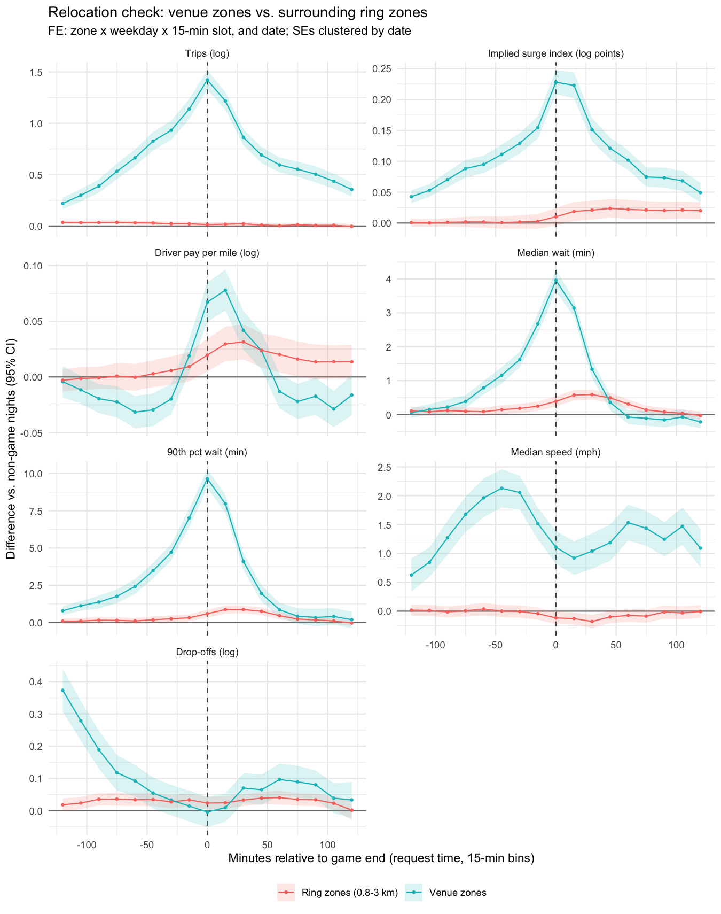

# Surge Pricing and Supply Response: Evidence from NYC Game Endings

When a game ends at Madison Square Garden, thousands of people ask for an Uber or Lyft at once.
How much do prices rise, how many extra rides get supplied, and how long do riders wait?
This project uses the end of **310 NBA, NHL and MLB home games** at four New York City venues
in 2024 as sudden demand shocks. Game endings serve as an instrument for price, which identifies the
**supply response to surge pricing** using only public trip records.

*Tran Nguyen Khoi Luu · ECO1400 term paper, University of Toronto (work in progress, Nov 2026).
Code in R (`duckdb`, `data.table`, `fixest`).*

## Key results (all 2024, 4 venues, 310 games)

| | Estimate | Meaning |
|---|---|---|
| First stage | 0.176 (SE 0.009), F ≈ 6,500 | The implied surge index rises about 19% in the hour after a game ends |
| Reduced form | 1.02 (SE 0.04) | Trips rise to about 2.8× a normal night |
| 2SLS supply elasticity | **5.6** (SE 0.28) | Stable with borough × date fixed effects (5.59) and weather controls (5.57) |
| Waits | +4 min median, +10 min at the 90th percentile | Price does not clear the market alone; waiting rations part of it |

**What the figures show**
- **Venue zones** (blue): trips, surge, driver pay and waits all peak at game end.
- **Zones 0.8–3 km away** (red): no fall in trips. Drivers drawn to the venue do not visibly drain nearby areas.
- **By league** ([figure](output/figures/es_by_league.png)): NBA and NHL games are flat until 30 minutes
  before the end, then spike, so they are the cleanest shocks. Baseball builds up over 2 hours as fans leave during the late innings.
- **Surprise end times** ([figure](output/figures/es_surprise.png)): baseball games that ran 15+ minutes late
  show a bigger surge (0.25 vs 0.20) and longer waits, but the same elasticity (5.8 vs 6.0). Drivers arriving
  in advance do not appear to drive the large estimate.

## Method

1. **Panel:** every Uber/Lyft trip in 2024 (about 20 million a month) is collapsed to pickup taxi zone × 15-minute bins by request time.
2. **Price measure, the implied surge index:** the public data has no surge multiplier, so a monthly rate card is
   fitted for each company (log fare on log miles, log minutes, airport). A trip's residual measures how much more
   it cost than a typical trip of the same length and duration.
3. **Event study:** outcomes from 2 hours before to 2 hours after each game end, against the same zone, weekday and
   time slot on non-game nights, with date fixed effects; SEs clustered by date.
4. **IV / 2SLS:** the first hour after a game end instruments for price.
5. **Checks:** a ring-zone relocation test, splits by venue and league, surprise end times, and weather controls.
6. **Planned:** quantile regression on waits, double machine learning, and a welfare comparison of surge vs. a fixed price.

The causal diagram and the list of threats are in [`output/figures/dag.png`](output/figures/dag.png) and
[`output/tables/dag_variables.csv`](output/tables/dag_variables.csv).

## Reproduce

Open `NYC_Surge_Project.Rproj` (so scripts run from this folder), then run the scripts in order. The trip panel is
not stored in this repository (550 MB); `01_build_panel.R` downloads each month from the TLC, builds the panel, and
deletes the raw file. The scripts need about 4 GB of RAM.

| Script | What it does | Output |
|---|---|---|
| `code/00_setup.R` | packages, paths, venue zones | — |
| `code/00b_venue_zones.R` | venue taxi zones + spillover zones (<800 m) from the TLC shapefile | `data/events/venue_zones.csv`, `taxi_zone_lookup.csv` |
| `code/01_build_panel.R 2024-01 ... 2024-12` | downloads each month once, fits the rate card, collapses to zone × 15-min bins | `data/derived/panel_YYYY-MM.parquet` (~48 MB/month, not in repo) |
| `code/02_events.R` | Knicks, Rangers, Nets (2023-24, 2024-25) + Yankees, Mets (2024) home games: start, length, end, attendance | `data/events/games_2024.csv` (310 games ending in 2024) |
| `code/02b_weather.R` | hourly 2024 weather, Open-Meteo (ERA5) | `data/events/weather_2024_hourly.csv` |
| `code/03_pilot_event_study.R` | pilot: MSG, March 2024 | `output/figures/pilot_msg_event_study.png` |
| `code/04_dag.R` | causal diagram + table of confounders and exclusion threats | `output/figures/dag.png` |
| `code/05_full_event_study.R` | **main results**: event study, relocation check, IV table, IV by venue, summary stats (~3 min) | `output/figures/es_all_venues.png`, `es_relocation.png`; `output/tables/iv_main.tex`, `iv_by_venue.csv`, `summary_stats.csv` |
| `code/06_surprise_end.R` | surprise end times and league split (~5 min) | `output/figures/es_surprise.png`, `es_by_league.png`; `output/tables/iv_by_surprise.csv` |

`code/lib_event_panel.R` builds the event panel shared by 05 and 06. Add `test` to run 05 or 06 on March only
(`Rscript code/05_full_event_study.R test`).

## Data sources

- [NYC TLC High Volume FHV Trip Records](https://www.nyc.gov/site/tlc/about/tlc-trip-record-data.page)
  (backup copy: NYC Open Data `bqxa-629f`)
- [Basketball-Reference](https://www.basketball-reference.com/), [Hockey-Reference](https://www.hockey-reference.com/),
  [MLB Stats API](https://statsapi.mlb.com/): start times, game lengths, attendance
- [Open-Meteo historical weather](https://open-meteo.com/en/docs/historical-weather-api) (ERA5)
- Literature map: `literature/NYC_surge_literature_review.xlsx` (built by `literature/build_lit_review.py`)

## Open issues

- Concerts on non-game nights at MSG and Barclays still sit in the comparison nights; the arenas' event calendars are needed.
- WNBA Liberty games (Barclays) are not yet in the events file.
- Wait time is missing for about 27% of trips (no driver-arrival timestamp).
- Completed trips are not a clean measure of supply when waits also rise, so β ≈ 5–6 should be read as a short-run response, with a range used in the welfare step.
- The TLC download server rate-limits repeated requests (HTTP 403). `01_build_panel.R` downloads each month once; if blocked, wait an hour or use NYC Open Data `bqxa-629f`.
